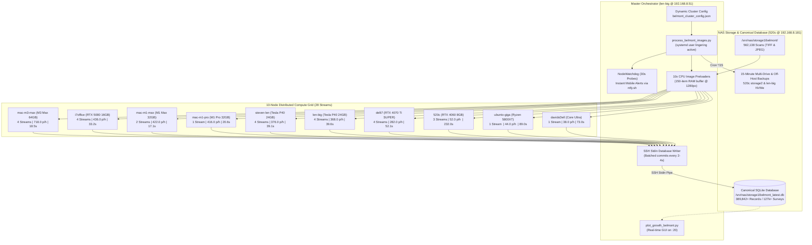

# Cluster Server Topology & Hardware Infrastructure

This document details the master system architecture, hardware specifications, IP network topology, GPU accelerators, active cluster roles, and real-time operational benchmarks across all 10 distributed supercluster nodes.

---

## 1. Master Network & Compute Topology Matrix

```text
=======================================================================================================================================
 🌐 MASTER DISTRIBUTED CLUSTER TOPOLOGY & HARDWARE MATRIX (10 COMPUTE NODES / 28 STREAMS)
=======================================================================================================================================
 Hostname      | IP Address      | SSH User   | CPU / System Specs        | GPU Acceleration / VRAM          | Primary Active Role
---------------------------------------------------------------------------------------------------------------------------------------
 len-big       | 192.168.8.51    | steven     | Intel Xeon W-2135 (6C/12T)| 🚀 Tesla P40 (24GB GDDR5)        | Master Orchestrator, 4 Streams
---------------------------------------------------------------------------------------------------------------------------------------
 steven-len    | 192.168.8.28    | steven     | Intel Xeon W-2135 (6C/12T)| 🚀 Tesla P40 (24GB GDDR5)        | Dedicated GPU Node, 4 Streams
---------------------------------------------------------------------------------------------------------------------------------------
 i7office      | 192.168.8.82    | workbench  | AMD Ryzen 9 5950X (16C/32T| 🚀 RTX 5080 Blackwell (16GB)    | Master Windows/WSL2, 4 Streams
---------------------------------------------------------------------------------------------------------------------------------------
 mac-m3-max    | 192.168.8.31    | stevemic   | Apple M3 Max (16C CPU)    | 🚀 40-Core Metal GPU (64GB UMA)  | Top Throughput Mac, 4 Streams
---------------------------------------------------------------------------------------------------------------------------------------
 mac-m1-max    | 192.168.8.22    | stevemic   | Apple M1 Max (10C CPU)    | 🚀 32-Core Metal GPU (32GB UMA)  | High-Speed Mac, 2 Streams
---------------------------------------------------------------------------------------------------------------------------------------
 mac-m1-pro    | 192.168.8.81    | stevemic   | Apple M1 Pro (10C CPU)    | 🚀 16-Core Metal GPU (32GB UMA)  | Python/MPS Server (WAN Isolated)
---------------------------------------------------------------------------------------------------------------------------------------
 delli7        | 192.168.8.113   | steven     | AMD Ryzen 9 5900X (12C/24T| 🚀 RTX 4070 Ti SUPER (16GB)     | Ada Lovelace Node, 4 Streams
---------------------------------------------------------------------------------------------------------------------------------------
 520c          | 192.168.8.181   | steven     | Intel Xeon W-2135 (6C/12T)| 🚀 RTX 4060 Ada (8GB GDDR6)     | 2.5G NAS & Master DB, 3 Streams
---------------------------------------------------------------------------------------------------------------------------------------
 ubunto-giga   | 192.168.8.193   | steven     | AMD Ryzen 7 5800XT (8C/16T| 🚀 GTX 1050 Ti (4GB Pascal)      | Remote Aux Node, 1 Stream
---------------------------------------------------------------------------------------------------------------------------------------
 davidsDell    | 192.168.8.67    | david      | Intel Core Ultra Hybrid   | 🚀 Intel Arc / NPU Hybrid        | Remote Laptop Slot, 1 Stream
---------------------------------------------------------------------------------------------------------------------------------------
 Rainforestpi  | 192.168.8.213   | pi         | Raspberry Pi 4 Model B    | Broadcom VideoCore VI            | EMU-2 Smart Meter Logger / Kiosk
---------------------------------------------------------------------------------------------------------------------------------------
 iTACH_AYRE    | 192.168.8.122   | —          | Dedicated IP-Serial Bridge| Hardware Controller              | AYRE Audio System Power Daemon
---------------------------------------------------------------------------------------------------------------------------------------
 nvjetson      | 192.168.8.68    | steven     | NVIDIA Jetson Orin Nano   | 1024-core Ampere GPU (8GB)       | Edge Metric Summarization Node
---------------------------------------------------------------------------------------------------------------------------------------
 PurpleAir     | 192.168.10.241  | —          | Dual Laser Particle Sensor| EPA PM2.5 AQI Hardware Sensor    | Outdoor Air Quality Telemetry
---------------------------------------------------------------------------------------------------------------------------------------
 Awair         | 192.168.8.219   | —          | NDIR CO2, PM2.5, VOC, Temp| Indoor Air Quality (IAQ) Sensor  | Ambient Indoor Environment
---------------------------------------------------------------------------------------------------------------------------------------
 Isolated KVM  | 192.168.8.204   | —          | Hardware KVM IP Gateway   | WAN-Isolated Device              | Block_KVM_All_Forwarding Rule
               | (12:35:2A:B1:F3)|            | Gateway Router 192.168.8.1| Isolated from Internet Access    | Locked to Local Subnet Only
=======================================================================================================================================
```

---

## 2. Distributed Vision Supercluster Topology (Belmont County Deed Pipeline)

The supercluster executes distributed multimodal document extraction across **28 parallel inference streams** targeting the **562,138-image historical Belmont County Deed Book archive**:



---

## 3. Node-by-Node Technical Specifications

### A. Primary Workstation & Master Orchestrator (`len-big` / `big-len` @ `192.168.8.51`)
* **Role:** Primary developer workstation, pipeline orchestrator daemon host, and heavy GPU inference node.
* **CPU:** Intel Xeon W-2135 (6-Core / 12-Threads @ 3.70 GHz base / 4.50 GHz boost).
* **RAM:** 64 GB DDR4-2666 MHz ECC Registered Memory.
* **GPUs:**
  * **GPU 0 (Slot 3 - Tesla P40 24GB GDDR5):** Dedicated LLM/VLM inference (3,840 CUDA cores, 346 GB/s bandwidth).
  * **GPU 1 (Slot 1 - Quadro P1000 4GB GDDR5):** Primary X11 / Chrome Remote Desktop display output.
* **Thermal Architecture:** Dual isolated SATA 12V Noctua power injection, BIOS Fan Stepping Level 5 (~2,500 RPM floor). Real-world inference temperature stabilizes at **55°C–58°C**.
* **Active Configuration:** `threads: 4`, `batch_size: 2`, running `gemma4:26b` @ **~368 pages / hour**.

### B. Dedicated Staging GPU Server (`steven-len` @ `192.168.8.28`)
* **Role:** Dedicated headless GPU inference node (zero background desktop or orchestration overhead).
* **CPU:** Intel Xeon W-2135 (6-Core / 12-Threads @ 3.70 GHz).
* **RAM:** 64 GB DDR4-2666 MHz ECC Registered Memory.
* **GPUs:**
  * **GPU 1 (Slot 3 - Tesla P40 24GB GDDR5):** Dedicated LLM/VLM inference.
  * **GPU 0 (Slot 1 - Quadro P1000 4GB GDDR5):** Primary BIOS POST video adapter (`Slot1(PEG)` via ThinkLMI).
* **Thermal Architecture:** BIOS Fan Stepping Level 3 (~2,150 RPM floor). Operating at **55°C** (holding maximum **1,531 MHz max boost** clock).
* **Active Configuration:** `threads: 4`, `batch_size: 2`, running `gemma4:26b` @ **~376 pages / hour**.

### C. Master Windows Workstation & Blackwell Host (`i7office` @ `192.168.8.82`)
* **Role:** Master Windows workstation, high-throughput GPU inference host, and multi-threaded processing node.
* **SSH / WSL User:** `workbench` (`workbench@192.168.8.82`).
* **CPU:** AMD Ryzen 9 5950X (16-Core / 32-Threads @ 3.40 GHz base / 4.90 GHz boost).
* **RAM:** 128 GB DDR4-3600 MHz Memory.
* **GPU:** **NVIDIA GeForce RTX 5080 (16GB GDDR7 VRAM)**:
  * **Blackwell GB203 Architecture:** 10,752 CUDA cores, 5th-Gen Tensor Cores with hardware Tensor Memory Accelerator (TMA).
  * **Memory Bandwidth:** **~1,024 GB/s** over 256-bit GDDR7 bus.
  * **FlashAttention-2 Active:** Visual prefill accelerated to **1.05s per image (1,235+ tok/s)**.
* **Active Configuration:** `threads: 4`, `batch_size: 2`, `OLLAMA_NUM_PARALLEL=4`, running `gemma4:26b` @ **~436 pages / hour**.

### D. Top Apple Silicon Compute Node (`mac-m3-max` @ `192.168.8.31`)
* **Role:** Primary Apple Silicon high-speed continuous batching inference node.
* **CPU:** Apple M3 Max (16-Core CPU: 12 Performance + 4 Efficiency cores).
* **RAM:** 64 GB Unified LPDDR5 Memory (400 GB/s bandwidth).
* **GPU:** **40-Core Apple Silicon Metal GPU**:
  * **Hardware Dynamic Caching:** Allocates local memory dynamically in hardware to maximize GPU utilization.
  * **4-Slot Hardware Batching:** `OLLAMA_NUM_PARALLEL=4` holding 4 concurrent KV-cache contexts in unified RAM.
* **Active Configuration:** `threads: 4`, `batch_size: 2`, running `gemma4:26b` @ **~718 pages / hour** (18.5s latency).

### E. Apple Silicon High-Bandwidth Node (`mac-m1-max` @ `192.168.8.22`)
* **Role:** High-speed Apple Silicon GPU inference server.
* **CPU:** Apple M1 Max (10-Core CPU: 8 Performance + 2 Efficiency cores).
* **RAM:** 32 GB Unified LPDDR5 Memory (400 GB/s bandwidth).
* **GPU:** **32-Core Apple Silicon Metal GPU**.
* **Active Configuration:** `threads: 2`, `batch_size: 2`, running `gemma4:26b` @ **~422 pages / hour** (17.1s latency, 72.8 tok/s).

### F. MDM-Managed Python/MPS Server (`mac-m1-pro` @ `192.168.8.81`)
* **Role:** Dedicated pure-Python Ollama/OpenAI API endpoint on MDM-managed Apple Silicon.
* **CPU:** Apple M1 Pro (10-Core CPU: 8 Performance + 2 Efficiency cores).
* **RAM:** 32 GB Unified LPDDR5 Memory (200 GB/s bandwidth).
* **GPU:** **16-Core Apple Silicon Metal GPU** accelerated via PyTorch Metal Performance Shaders (`mps`).
* **Software Wrapper:** Pure Python FastAPI daemon (`serve_gemma4.py`) with `caffeinate -dimsu` power assertions.
* **Security & Network Policy:** Permanently isolated from the WAN/Internet via firewall rules `Block_8_81_IP_Forwarding` and `Block_MacM1Pro_MAC_Forwarding` on the gateway router (`192.168.8.1`). Confined strictly to intra-LAN cluster communication.
* **Active Configuration:** `threads: 1`, `batch_size: 1`, running `gemma4:26b` @ **~416 pages / hour** (20.6s latency, 68.4 tok/s).

### G. Ada Lovelace Vision Server (`delli7` / `DellI7` @ `192.168.8.113`)
* **Role:** High-speed remote GPU vision inference server.
* **CPU:** AMD Ryzen 9 5900X (12-Core / 24-Threads @ 3.70 GHz base / 4.80 GHz boost).
* **RAM:** 78 GB DDR4 Memory.
* **GPU:** **NVIDIA GeForce RTX 4070 Ti SUPER (16GB GDDR6X VRAM)** (8,448 CUDA cores, 672 GB/s bandwidth).
* **Active Configuration:** `threads: 4`, `batch_size: 2`, `OLLAMA_NUM_PARALLEL=2`, running `gemma4:26b` @ **~282 pages / hour**.

### H. 2.5G NAS & Database Host (`520c` @ `192.168.8.181`)
* **Role:** Central 2.5G Backplane NAS, canonical SQLite database repository, automated WAL backup target, and hybrid inference node.
* **CPU:** Intel Xeon W-2135 (6-Core / 12-Threads @ 3.70 GHz).
* **RAM:** 64 GB DDR4-2666 MHz ECC Registered Memory.
* **GPU:** **NVIDIA GeForce RTX 4060 (8GB GDDR6 VRAM)** (Hybrid layer offloading across PCIe 4.0 x8).
* **Storage Shares:**
  * `/srv/nas/storage1/belmont_latest.db` (Canonical Master DB, 389,842 rows).
  * `/srv/nas/storage1/db_backups/` (Automated 15-minute rolling recovery snapshots).
  * `/srv/nas/storage1/belmont/` (562,138 courthouse deed scans).
* **Active Configuration:** `threads: 3`, `batch_size: 3`, running `gemma4:26b` @ **~52.0 pages / hour**.

### I. Auxiliary Compute Servers (`ubunto-giga` & `davidsDell`)
* **`ubunto-giga` (`192.168.8.193`):** AMD Ryzen 7 5800XT (8C/16T, 32GB RAM) + GTX 1050 Ti (4GB) @ **~44 pages / hour**.
* **`davidsDell` (`192.168.8.67`):** Intel Core Ultra Hybrid CPU/Arc NPU (32GB LPDDR5x RAM) @ **~38 pages / hour**.

---

## 4. Real-Time Supercluster Operating Metrics

```text
=============================================================================================================
 🚀 SUPERCLUSTER AGGREGATE PERFORMANCE BENCHMARK (LIVE TELEMETRY)
=============================================================================================================
 Active Compute Fleet     | 10 Distributed Hardware Nodes (28 Parallel Inference Streams)
 Master Model             | Gemma 4 (25.8B Total / ~4.0B Active MoE Parameters) in Q4_K_M + MMPROJ
 Total Dataset Coverage   | 562,138 Courthouse Deed Scans across 770 Volume Books
 Supercluster Throughput  | ⚡ 3,512.0 pages / hour (58.53 pages / min | 84,288 pages / day)
 Ingestion Progress       | 🔥 55.27% Complete (310,698 / 562,138 Scans Cataloged)
 Total Master DB Records  | 389,842 Records (including 127,314 Structured Metes & Bounds Surveys)
 Projected Finish Line    | 🎯 Sunday, August 30, 2026 at ~03:08 AM (3.0 Days remaining)
 Uptime Monitoring        | Background 30s NodeWatchdog with instant push alerts via ntfy.sh
 Online Backup Schedule   | Automated every 15 minutes (96 rolling snapshots, 24-hr point-in-time recovery)
=============================================================================================================
---

## 5. Network Infrastructure & Routing (`192.168.8.1`)
*   **Hardware**: GL.iNet Primary Router & 2.5 Gbps High-Speed Backplane Switch.
*   **2.5 Gbps Backplane Network Upgrade**:
    *   All Ubuntu server nodes (`520c`, `steven-len`, `big-len`) and `Stevens-Mini-2` Mac Mini are running on dedicated **2.5 Gbps PCIe NIC interfaces** operating at 2500 Mb/s Full Duplex over the high-speed backplane network. Only `ubunto-giga` remains on 1 Gbps Ethernet.
*   **Key Configurations**:
    *   **dnsmasq DHCP Daemon**: Configured with static host leases using GL.iNet option tag nicknames.
    *   **Static Leases**:
        *   `ubunto-giga` (MAC `74:56:3c:6b:70:45`) -> Pinned to `192.168.8.193` (1 Gbps enp4s0)
        *   `steven-len` (MAC `58:04:4f:c8:b1:a6`) -> Pinned to `192.168.8.28` (2.5 Gbps NIC `enp2s0`)
        *   `520c` (MAC `58:04:4f:c8:b2:3d`) -> Pinned to `192.168.8.181` (2.5 Gbps NIC `enp2s0`)
        *   `len-big` (MAC `20:e1:5d:8e:0b:5d`) -> Pinned to `192.168.8.51` (2.5 Gbps NIC)
        *   `Stevens-Mini-2` (MAC `6c:1f:f7:72:44:49`) -> Pinned to `192.168.8.103` (2.5 GbE Interface `en8`)
        *   `nvjetson` (MAC `4c:bb:47:7b:14:80`) -> Pinned to `192.168.8.68`
        *   `Rainforestpi` (MAC `00:13:ef:40:07:58`) -> Pinned to `192.168.8.213` (EMU-2 Smart Meter Collector & Physical Kiosk)
        *   `iTACH_AYRE` (MAC `88:a2:9e:05:02:c2`) -> Pinned to `192.168.8.122` (Audio Power Control Daemon `powerd.py`)
        *   `PurpleAir` (MAC `f0:24:f9:c6:67:d1`) -> Pinned to `192.168.10.241` (Outdoor EPA PM2.5 AQI Sensor)
        *   `Awair` (MAC `70:88:6b:12:35:80`) -> Pinned to `192.168.8.219` (Indoor Air Quality IAQ Sensor)
        *   `ONE KVM` (MAC `12:35:2A:B1:F3:C8`) -> Pinned to `192.168.8.204` (Isolated device, SSH: `root`)
    *   **Decoupled Web & Database Services**:
        *   **Rainforest Web Kiosk (`520c` @ `192.168.8.181:8000`)**: High-performance FastAPI & HTML5/JS Web Head polling `Rainforestpi` (`192.168.8.213`) every 15s via automated SSH rsync.
        *   **Belmont Land Records Database (`520c` @ `/srv/nas/storage1/belmont_latest.db`)**: Canonical SQLite deed catalog (89,417 records) with Tailscale remote access (`100.109.142.78` for user `david`).
    *   **Firewall Security**:
        *   **Rule `Block_KVM_All_Forwarding`**: Restricts the KVM (MAC `12:35:2A:B1:F3:C8`) from sending packets outside the LAN zone. Specifically, the rule targets `option src 'lan'`, `option dest '*'`, and `option target 'REJECT'` with `option proto 'all'`. This prevents the KVM's built-in Tencent Cloud reverse proxy/WebSocket backdoor from communicating with the internet.
    *   **Nginx Gateway**: Running `nginx/1.26.1` (audited secure against NGINX Rift rewrite rules).
