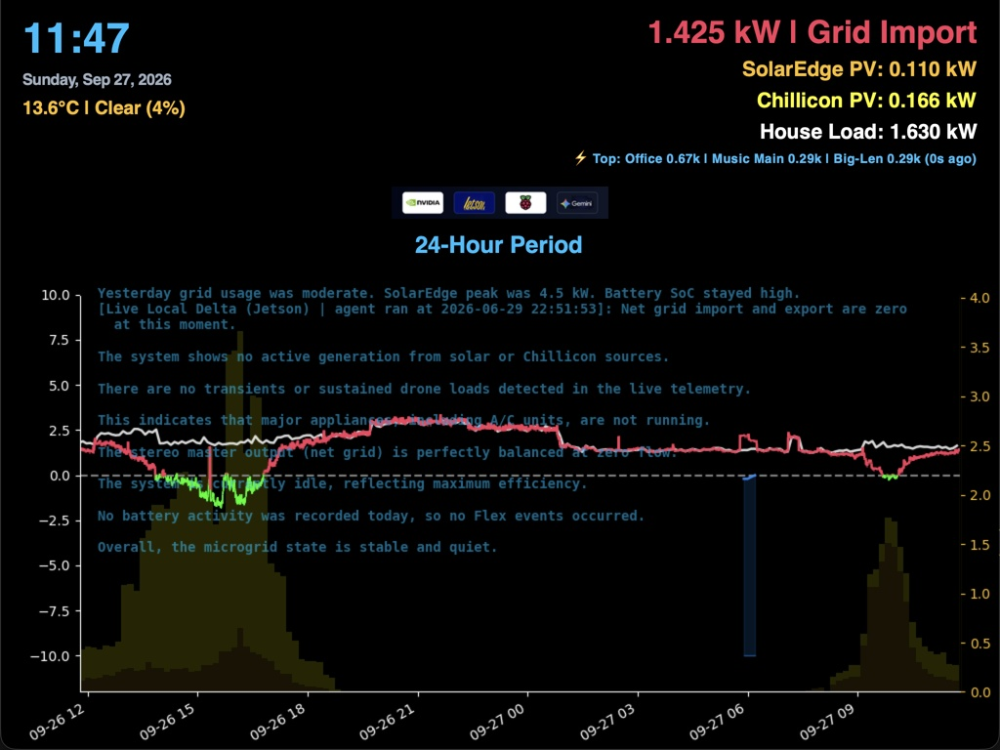
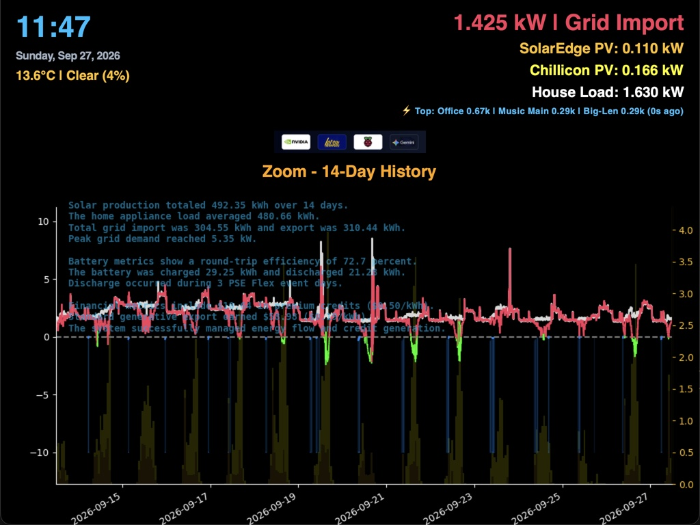
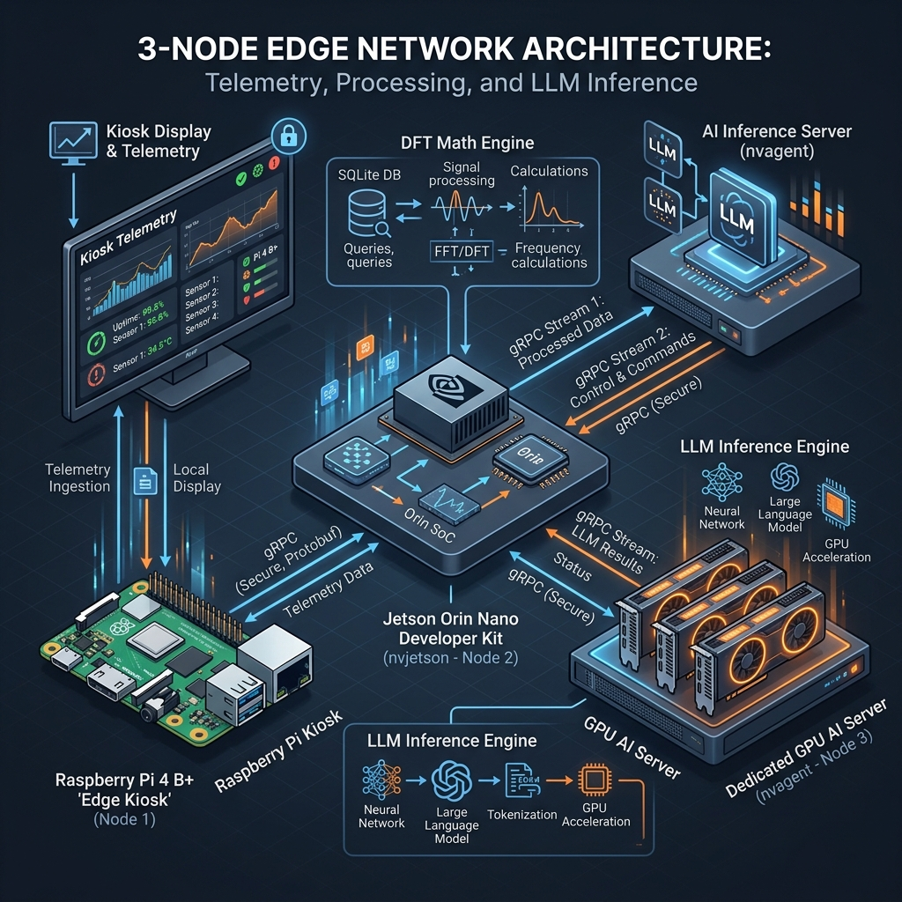
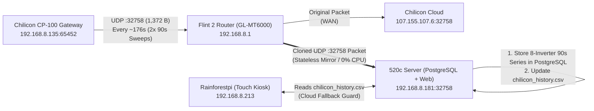
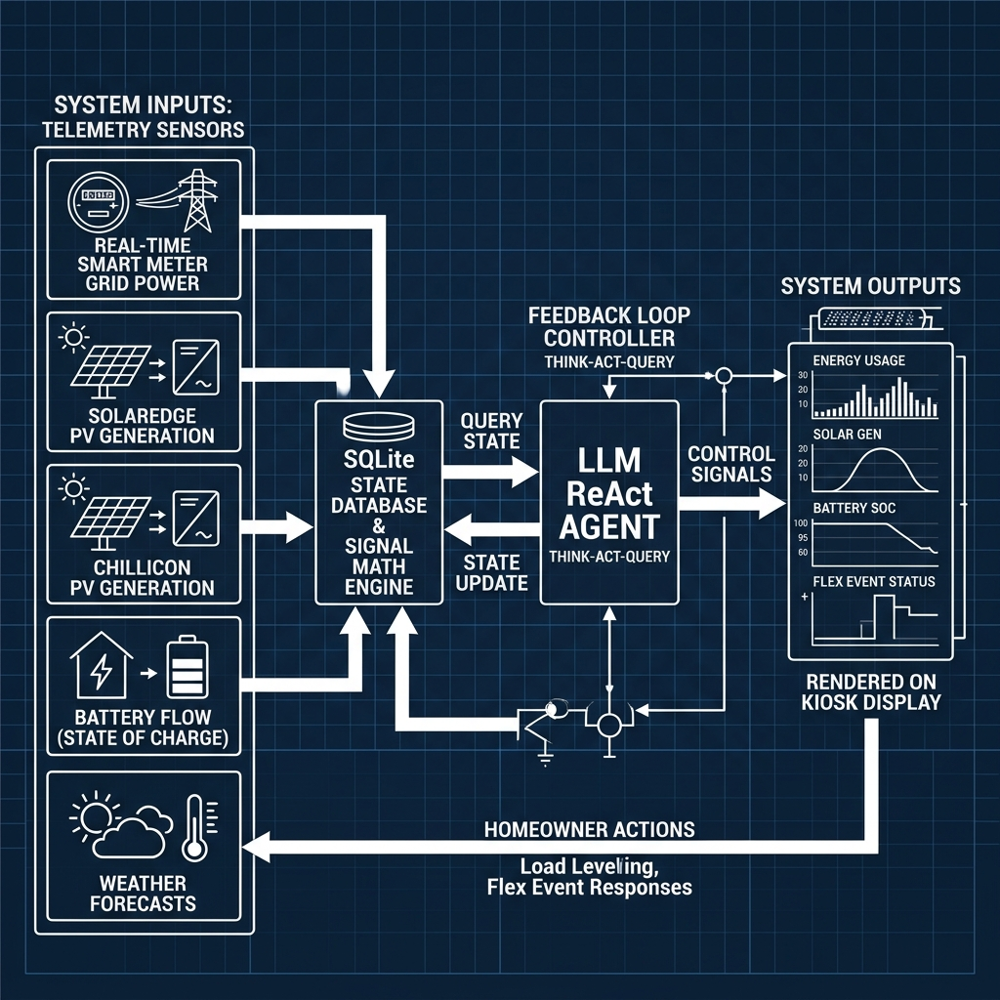
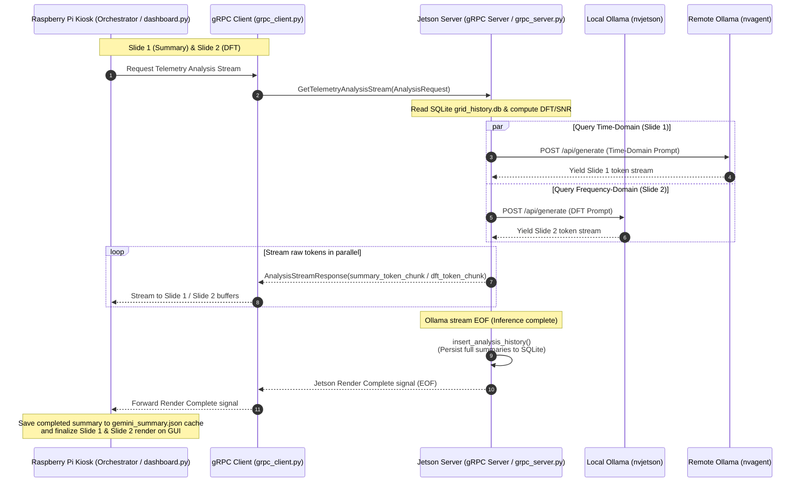
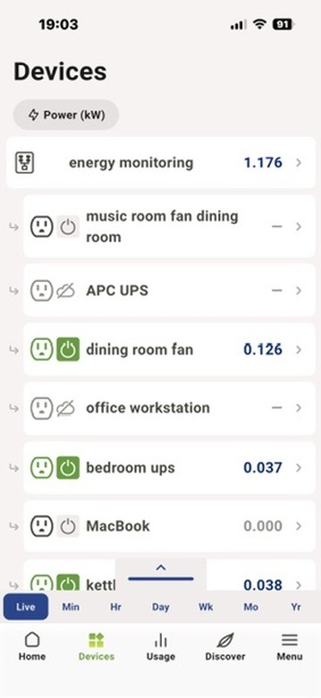
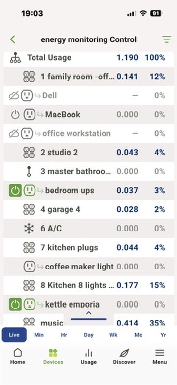
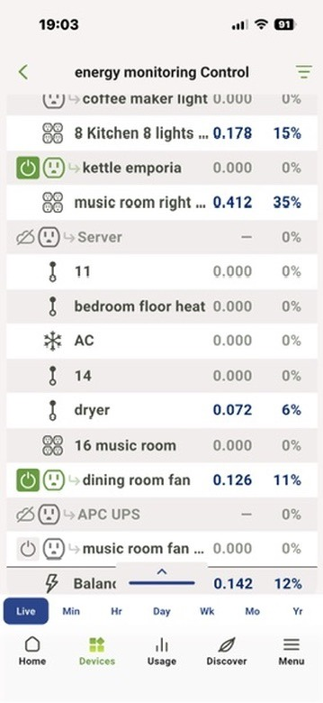
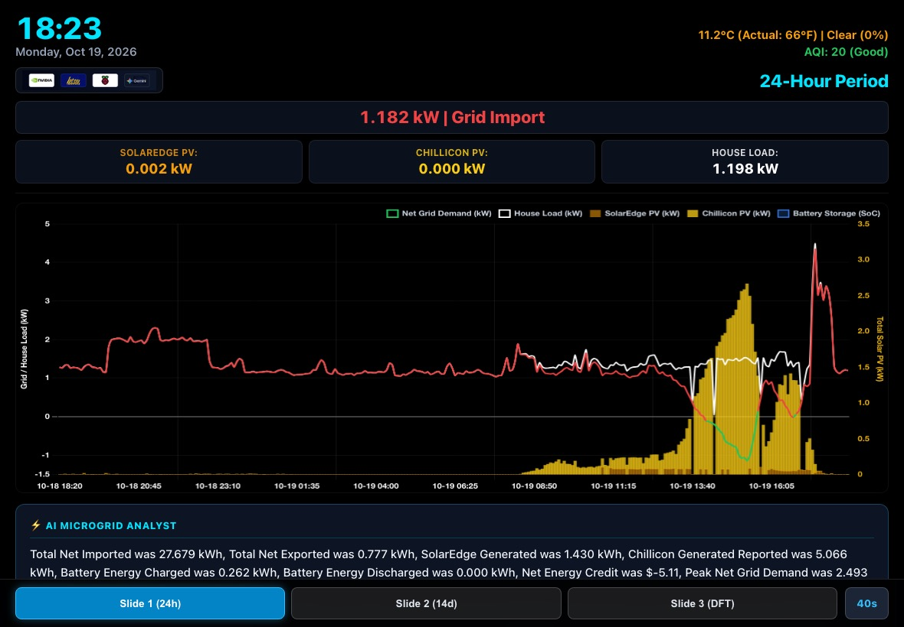

# EMU-2 Grid Dashboard




A robust, 24-hour real-time grid monitoring dashboard using a Rainforest EMU-2 smart meter connected to a Raspberry Pi. It automatically boots into a fullscreen kiosk mode over HDMI, safely bypasses modern Wayland graphic quirks, and seamlessly persists data to SQLite and local CSVs to survive power outages.

> [!NOTE]
> **Product & Compatibility Note:** The Rainforest EMU-2 is a legacy hardware product that has been discontinued. For deployments using current-generation hardware, the **Rainforest EAGLE 3** features a local API that outputs a very similar XML structure, making this dashboard framework highly compatible and adaptable for it.

## Hardware Requirements
- **Raspberry Pi** (Pi 3, 4, or 5 recommended)
- **Rainforest EMU-2** connected via USB (`/dev/ttyACM0`)
- **HDMI Monitor** (The script dynamically scales to fullscreen, mimicking commercial 10" or larger solar dashboards)
- **NVIDIA Jetson Orin Nano / Orin Nano Super Developer Kit** (Optional) - Dedicated local AI server (minimum 8GB unified memory recommended) to run decoupled local Edge AI offline. For a fully optimized, lag-free setup, a **second Jetson Orin** can be added to run the Google AI Edge SDK (MediaPipe) or Ollama as a dedicated headless inference server.

## Connecting to Your Smart Meter (PSE & Others)
Because the monitor reads data directly from the Zigbee wireless network inside your utility's smart meter, it must be paired and provisioned with the meter:
1. **Purchase the Device**: Rainforest monitors can be purchased directly from the [Rainforest US Retail Store](https://rainforest-store-us.myshopify.com/).
2. **Contact Puget Sound Energy (PSE)**: Call PSE Customer Care at **1-888-225-5773** and ask them to pair/provision a **"Home Area Network (HAN) device."** You will need to provide them with the device's **MAC Address** and **Install Code** printed on the label on the back of the monitor.
3. **Other Utilities**: If your utility provider is not PSE, contact your utility's customer service or search their website for "HAN provisioning" or "Smart Meter pairing" to follow their specific activation process.

## Key Features
- **Real-Time Data Parsing**: Decodes raw XML telemetry (`<InstantaneousDemand>`) directly from the EMU-2 serial port.
- **Rolling 24-Hour Graph**: Features a dynamic rolling 24-hour X-axis with the newest readings always positioned on the far right, ensuring the graph is always fully populated with historical context.
- **Persistent Data**: Logs grid demand automatically to an optimized SQLite database `grid_history.db` every 15 seconds (with automatic one-time migration of legacy `grid_history.csv` files on first boot), SolarEdge PV to `solaredge_history.csv` every 15 minutes, battery metrics to `solaredge_battery_history.csv` every 15 minutes, and Chilicon production to `chilicon_history.csv` every 90–180 seconds via local UDP broadcast (with 15-minute cloud fallback), retroactively reloading the graph and historical context immediately upon boot.
- **SolarEdge PV & Battery Integration**: Polls SolarEdge `/currentPowerFlow` to track real-time solar panel output, signed battery charge/discharge rates, and State of Charge (SoC %).
- **Chilicon Real-Time UDP 32758 Debug Bridge & Cloud Fallback**: Captures raw binary datagrams broadcast by the on-premise Chilicon CP-100 Gateway on port 32758, delivering ~90-second PLC sweeps across all 8 microinverters (AC voltage, MPPT currents, uptime, lifetime energy) to PostgreSQL and local CSVs with automatic fallback to the Chilicon Cloud API.
- **Stacked Solar PV Chart**: Stacks the actual Chilicon generation (plotted as a bright neon yellow cap) on top of the SolarEdge PV bars (warm gold base) on a unified 10-minute grid, displaying your total combined solar output on the secondary Y-axis.
- **Hands-Free Kiosk Mode**: Configured to boot completely headless and automatically launch into fullscreen without sleeping.
- **3-Slide Touch Kiosk & Web Mirror**: Features an automated rotating carousel (45s / 45s / 20s) across both the physical Pi touchscreen and the FastAPI Web Kiosk (`520c` @ `192.168.8.181:8000`):
  * **Slide 1 (24-Hour Period)**: High-resolution time-domain net grid kW, house load, solar generation bars, and battery SoC water floor with real-time local delta narrative overlay.
  * **Slide 2 (Zoom - 14-Day History)**: Multi-day energy progression with an interactive ReAct AI agent narrative analyzing seasonal sun shifts, solar vs load balance, and battery economics.
  * **Slide 3 (Circuit Breakdown & DFT Spectrum)**: Real-time whole-home circuit telemetry (Emporia Vue 200A mains, sub-panels, smart plugs) and frequency-domain harmonic analysis.
- **Mobile Responsive UI Wrapper**: Automatically adapts the web dashboard on smartphones and small touchscreens ($\le 768\text{px}$) with safe area insets (`viewport-fit=cover`), stacked metrics cards (SolarEdge, Chillicon, House Load), a dedicated high-contrast glassmorphism AI analysis card positioned beneath the chart, and a fixed $44\text{px}$ thumb navigation dock with auto-cycle pause/resume toggle—while preserving the exact $100\text{vw} \times 100\text{vh}$ desktop kiosk layout on larger screens.
- **Interactive 14-Day ReAct AI History Agent**: Powered by local edge LLMs (Apple Silicon M4 Mac Mini `Stevens-Mini-2` @ `192.168.8.103:11434` with 16GB unified memory headroom). Uses a multi-turn ReAct loop (up to 5 iterations) with direct read-only SQLite tool calling (`query_db`), pre-injected daily performance matrices, diurnal load profiles, and seasonal sun cycles (sunrise, sunset, daylight duration, PNW heating/solar shifts).
- **Hybrid Weather & PurpleAir Environmental Telemetry**: Fetches regional forecast metrics from Open-Meteo while integrating on-premise particulate matter (EPA PM2.5 AQI) and actual local ambient temperature (`(Actual: XX°F)`) polled directly from a local PurpleAir sensor (`192.168.10.241`).
- **AI Background Summaries**: Renders narrative, statistical, and mathematical analysis summaries directly on the graph background, formatted with smart line wrapping. Supports both Google Cloud Vertex AI and fully local edge models (Ollama/Gemma 4).

---

## AI Background Summaries & Authentication

The dashboard displays a narrative, statistical, and mathematical analysis summary directly on the graph watermark. To optimize resource consumption and isolate heavy inference loops from the real-time GUI, the dashboard utilizes a **Decoupled Architecture**:
- **Baseline Summary Generation (every 4 hours)**: Feeds bulk historical telemetry to the stager to update and cache a high-fidelity baseline summary.
- **Real-Time Delta Updates (every 15 minutes)**: Pulls lightweight delta updates and overlays them using the local edge server on the Nvidia Jetson.

The prompt includes hourly aggregated Net Grid import/export statistics, SolarEdge solar generation, battery stats (`Battery_Avg_kW` average discharge rate and `Battery_SoC` average charge percentage), and actual Chillicon generation (`Chillicon_Avg_kW`). This enables the model to make highly accurate summaries and correctly separate battery dispatch behavior during Puget Sound Energy (PSE) Flex events (reimbursed at a premium rate of **$0.50 / kWh** instead of the standard $0.19 / kWh) from your actual solar arrays' generation without needing mathematical inference.

> [!WARNING]
> **Prompt Personalization Warning:** The system prompts (such as `gemma_hybrid_prompt.txt` and `gemini_prompt.txt`) are heavily customized for the developer's specific microgrid layout, geographical/climatological constraints (e.g. South-West and North-West facing solar arrays, Seattle daylight windows), utility rates (Puget Sound Energy's standard and Flex event tiers), and lack of an EV (Electric Vehicle).
> Before publishing or deploying this project in your own environment, you should review and profile these prompts. We recommend using a powerful AI (such as Gemini) to adapt and tune these system instructions, orientation angles, and billing rules to match your specific home configuration and local utility plans.
### Supported AI Models

The architecture supports both cloud-based LLM APIs and local edge inference, depending on your deployment preferences:

#### 1. Cloud-Based Models (Google Cloud Vertex AI)
* **`gemini-2.5-flash`** (Default): Primary model used for compiling large 24-hour historical baselines. Runs via high-speed direct API or cost-optimized GCS batch jobs (with a 50% discount per token).
* **`gemini-2.5-pro`** (Optional): Can be configured for deeper qualitative microgrid reports or complex utility policy reasoning.

#### 2. Local Edge Models (Apple Silicon & Multi-Node Ollama Cluster)
* **`Stevens-Mini-2` (`192.168.8.103:11434`) - Primary Master Inference**: Runs on an Apple Silicon M4 Mac Mini with **16GB Unified Memory** (~120 GB/s bandwidth). Executes the `gemma4-it-q4:latest` model with an expanded **16,384-token context window (`num_ctx: 16384`)**, enabling multi-turn ReAct SQL loops, pre-injected 14-day telemetry matrices, and multi-step reasoning with zero memory contention.
* **`mac-m1-max` (`192.168.8.22:11434`) - Secondary High-Capacity Failover**: Apple Silicon M1 Max (32GB Unified Memory) hosting standard Ollama with native tool-calling and thinking support (`gemma4-it-q4:latest`, `gemma4:e4b`, `gemma4:26b`).
* **`520c` (`192.168.8.181:11434`) - Tertiary Accelerated Failover**: Intel Xeon workstation with an NVIDIA RTX 4060 GPU (8GB GDDR6) running standard Ollama services.
* **`ubunto-giga` (`192.168.8.193:11434`) & `i7office` (`192.168.8.82:11434`)**: Auxiliary and desktop workstation Ollama completion hosts.
* **`gemma4-vision-q4`** (Optional): Multimodal projector adapter allowing the local stager to perform computer vision analysis of the generated dashboard plots.

### Authentication Setup
The dashboard automatically authenticates using Vertex AI on Google Cloud:
1. **Google Cloud Service Account JSON:**
   - Place your service account JSON credentials key at `~/Auth/service_account.json` (or `auth/service_account.json` in the application directory).
   - The application dynamically sets the `GOOGLE_APPLICATION_CREDENTIALS` environment variable to point to this JSON file.
2. **GCP Project Configuration:**
   - Create a `.env` file in the same directory as `dashboard.py` and define your Google Cloud project and location:
     ```env
     GCP_PROJECT="your-gcp-project-id"
     GOOGLE_CLOUD_LOCATION="global"
     ```

### SolarEdge API Configuration
To enable SolarEdge PV and battery storage telemetry overlay and mathematical analysis in the Gemini prompt, configure your SolarEdge API credentials inside `~/Auth/solaredge_config.json` (or `auth/solaredge_config.json` in the application directory):
```json
{
  "api_key": "your_solaredge_api_key",
  "site_id": "your_solaredge_site_id"
}
```
*Note: If you do not have your SolarEdge API key or Site ID, you will need to contact your solar system installer to request API access for your monitoring account.*

### Chillicon Cloud API & Local UDP `32758` Debug Bridge Configuration
To enable the Chillicon Cloud API integration and/or local sub-minute UDP `32758` Debug Bridge telemetry, configure your credentials inside `~/Auth/chilicon_config.json` (or `auth/chilicon_config.json` in the application directory):
```json
{
  "username": "your_chilicon_email",
  "password": "your_chilicon_password",
  "installation_hash": "abcdef1234567890abcdef1234567890abcdef1234567890abcdef1234567890",
  "udp_port": 32758,
  "pg_dsn": "postgresql://postgres:<password>@<postgres-host>:5432/energy_telemetry"
}
```
*Note: To find your `installation_hash`, log in to your account at `https://cloud.chiliconpower.com`, click on your solar installation dashboard, and inspect the URL in your browser's address bar. The long hexadecimal string at the end of the URL is your installation hash:*
`https://cloud.chiliconpower.com/installation/abcdef1234567890abcdef1234567890abcdef1234567890abcdef1234567890`

#### Local Real-Time UDP `32758` Debug Bridge (`chilicon_udp_listener.py`)
The Chilicon CP-100 Gateway emits unencrypted `1,372-byte` UDP datagrams on port `32758` every ~176 seconds, containing two ~90-second Power Line Communication (PLC) sweeps across all bound CP-720 microinverters (`85 bytes` per inverter record).
* By mirroring or rebroadcasting outbound UDP `32758` packets from the gateway at the router level to your collector node(s), [`chilicon_udp_listener.py`](file:///Users/treven/Documents/rainforest-emu2-grid-dashboard/chilicon_udp_listener.py) decodes real-time per-panel AC voltage (`Q12.4`), DC1/DC2 MPPT channels, operating uptime, and exact $\Delta E / \Delta t$ AC wattage (`55,102.861851 ticks/kWh`).
* Appends 90-second system rollups directly to `chilicon_history.csv` (and optionally to PostgreSQL `energy_telemetry`), while `ChilliconClient.fetch_data()` automatically defers to fresh local UDP samples (`<= 360s` old) and only falls back to `cloud.chiliconpower.com` if local UDP packets are unavailable.

---

## Decoupled Architecture (Pi & Cloud Batch)

For production systems, this repository supports a **decoupled architecture**. This separates the resource-heavy LLM inference from the real-time Tkinter GUI process.

You can configure this using the `LLM_MODE` setting in your `.env` file:
* **`LLM_MODE=direct` (Default)**: The GUI runs an inline background thread that queries the remote Vertex AI API directly every 15 minutes. Best for simple, out-of-the-box local developer testing.
* **`LLM_MODE=decoupled`**: The GUI runs as a pure cache consumer, disabling internal API calls and polling `gemini_summary.json` every 10 seconds for updates. This lets the local Jetson edge server or an external background stager update the cache.

### Cloud Batch Staging (Raspberry Pi)
When running `LLM_MODE=decoupled` on the Raspberry Pi:
* Run the background script `stage_batch_summary.py` in a separate screen or service session.
* This script compiles the telemetry data, uploads it to GCS, schedules a **Vertex AI Batch Prediction** job, and polls the job state.
* **Significant Cost Savings**: Vertex AI Batch predictions offer a **50% discount** per token compared to direct synchronous API calls. Additionally, polling the job status is a metadata query which is **100% free** under Google Cloud, allowing the stager to check frequently without incurring any API polling costs.
* It persists the active job state to `active_batch_job.json` to safely resume polling even across unexpected reboots (watchdog recovery).

Detailed instructions on how to set up the necessary Google Cloud Storage buckets, service accounts, and permissions for the Vertex AI Batch prediction environment can be found in the [Gemini Photo Batch Workflow repository](https://github.com/smichalove/Gemini_Photo_Batch_Workflow).

## gRPC & SQLite Local Decoupled Architecture

For local Edge AI deployments (Nvidia Jetson Orin), the communication protocol is upgraded from HTTP/REST to **gRPC** on port `50051` with mutual TLS (mTLS) zero-trust authentication. This provides high-performance telemetry streaming and real-time AI response token rendering.

### 1. High-Level Network Topology Diagram


```mermaid
flowchart TD
    subgraph Pi [Raspberry Pi Kiosk: Rainforestpi @ 192.168.8.213]
        GUI[dashboard.py / Tkinter GUI]
        Client[grpc_client.py]
    end
    subgraph Jetson [Edge Stager: nvjetson @ 192.168.8.68]
        Server[grpc_server.py: port 50051]
        DB[(backups/grid_history.db)]
    end
    subgraph InferenceCluster [Local Ollama AI Inference Cluster]
        MacMini[Primary Master: Stevens-Mini-2 @ 192.168.8.103<br/>M4 Mac Mini 16GB / 16k ctx / ReAct Loop]
        M1Max[Secondary Failover: mac-m1-max @ 192.168.8.22<br/>M1 Max 32GB / Standard Tools]
        XeonNode[Tertiary Failover: 520c @ 192.168.8.181<br/>Xeon + RTX 4060 / Web Kiosk Mirror]
    end

    GUI -->|1. Request telemetry update| Client
    Client -->|2. Secure gRPC stream (port 50051)| Server
    Server -->|3. Query historical records| DB
    Server -->|4. Interactive ReAct SQL tool loop / Narrative stream| MacMini
    MacMini -.->|Failover if busy/offline| M1Max
    M1Max -.->|Failover| XeonNode
    MacMini -->|5. Stream verified tokens| Server
    Server -->|6. Stream response chunks| Client
    Client -->|7. Render Slide 1, Slide 2 & Slide 3| GUI
```

### 2. Core System Classes
The application codebase is structured into the following key logical classes:
*   **`GridDashboard`** ([dashboard.py](file:///Users/treven/Documents/rainforest-emu2-grid-dashboard/dashboard.py)): The central supervisor and Tkinter GUI application. Runs the Matplotlib plotting loop, manages fullscreen kiosk states, launches headless reading threads, and handles token stream queue consumers.
*   **`OfflineViewer`** ([render_local_plot.py](file:///Users/treven/Documents/rainforest-emu2-grid-dashboard/render_local_plot.py)): A headless local render emulator that runs Tkinter to plot historical CSV/SQLite data to static files for local visual verification.
*   **`SolarEdgeClient`** ([dashboard_modules/solar.py](file:///Users/treven/Documents/rainforest-emu2-grid-dashboard/dashboard_modules/solar.py)): An asynchronous HTTP client wrapper for the SolarEdge API. Fetches `/currentPowerFlow` telemetry and converts raw solar arrays and battery SOC indicators.
*   **`ChilliconClient`** ([dashboard_modules/solar.py](file:///Users/treven/Documents/rainforest-emu2-grid-dashboard/dashboard_modules/solar.py)): Scrapes solar production variables from the Chillicon gateway using persistent session cookie authentication.
*   **`GridTelemetryClient`** ([dashboard_modules/grpc_client.py](file:///Users/treven/Documents/rainforest-emu2-grid-dashboard/dashboard_modules/grpc_client.py)): Encapsulates the secure gRPC stub connection. Requests streamed tokens from the stager using mTLS credentials.
*   **`GridTelemetryService`** ([dashboard_modules/grpc_server.py](file:///Users/treven/Documents/rainforest-emu2-grid-dashboard/dashboard_modules/grpc_server.py)): The gRPC server implementation running on `nvjetson`. Computes DFT sinusoids, executes a dual-node proposer-verifier feedback loop (querying the local proposer model on `nvjetson` for initial drafts and streaming verified critiques from the remote GPU server `nvagent`), and streams the finalized token chunks to the client.

### 3. Protobuf API Schema (`protos/grid_telemetry.proto`)
The cross-node interface contracts are defined in [grid_telemetry.proto](file:///Users/treven/Documents/rainforest-emu2-grid-dashboard/protos/grid_telemetry.proto):
```protobuf
syntax = "proto3";
package grid;
import "google/protobuf/timestamp.proto";

service GridTelemetryService {
  rpc EvaluateTelemetrySlice(TelemetrySlice) returns (TelemetryResponse);
  rpc GetTelemetryAnalysisStream(AnalysisRequest) returns (stream AnalysisStreamResponse);
}

message TelemetryRequest {
  google.protobuf.Timestamp timestamp = 1;
  double grid_usage_kw = 2;
  double solaredge_pv_kw = 3;
  double solaredge_battery_kw = 4;
  double solaredge_battery_soc = 5;
  double solaredge_load_kw = 6;
  double solaredge_import_kw = 7;
  double solaredge_export_kw = 8;
  double chilicon_pv_kw = 9;
  double chilicon_lifetime_wh = 10;
}

message TelemetrySlice {
  string slice_id = 1;
  google.protobuf.Timestamp start_timestamp = 2;
  google.protobuf.Timestamp end_timestamp = 3;
  double dft_period_hours = 4;
  repeated TelemetryRequest readings = 5;
  SpectralMetrics spectral_metrics = 6;
}

message SpectralMetrics {
  double solar_24h_amp = 1;
  double solar_24h_peak_hour = 2;
  double grid_24h_amp = 3;
  double grid_12h_amp = 4;
  double grid_12h_peak_hour = 5;
  double grid_bimodal_ratio = 6;
  double grid_24h_snr_db = 7;
  double grid_12h_snr_db = 8;
  double solar_24h_snr_db = 9;
  double consumption_24h_snr_db = 10;
  double consumption_12h_snr_db = 11;
  double solar_slope = 12;
  double grid_slope = 13;
  repeated double freqs = 14;
  repeated double grid_amp_spec = 15;
  repeated double solar_amp_spec = 16;
  repeated double consumption_amp_spec = 17;
  repeated double expected_solar_amp_spec = 18;
}

message AnalysisRequest {
  google.protobuf.Timestamp baseline_timestamp = 1;
  string baseline_text = 2;
  int32 batch_interval_hours = 3;
}

message AnalysisResponse {
  google.protobuf.Timestamp timestamp = 1;
  string baseline_text = 2;
  google.protobuf.Timestamp baseline_timestamp = 3;
  string summary_text = 4;
  string dft_explanation = 5;
  double delta_import = 6;
  double delta_export = 7;
  double delta_peak = 8;
  double delta_solar = 9;
  double delta_se_solar = 10;
  double delta_ch_solar = 11;
  double delta_bat_charge = 12;
  double delta_bat_discharge = 13;
  double delta_se_load = 14;
  double expected_temp_max = 15;
  double expected_cloud_cover = 16;
  SpectralMetrics spectral_metrics = 17;
}

message AnalysisStreamResponse {
  optional AnalysisResponse initial_analysis = 1;
  string summary_token_chunk = 2;
  string dft_token_chunk = 3;
}

message TelemetryResponse {
  bool success = 1;
  string message = 2;
}
```

### 4. Relational Database Schemas
Telemetry metrics and historical reports are persisted locally in two relational SQLite databases:

#### A. High-Frequency Telemetry Database (`backups/grid_history.db`)
Stores real-time 15-second grid usage readings compiled from the EMU-2 serial interface:
```sql
CREATE TABLE IF NOT EXISTS grid_history (
    timestamp TEXT PRIMARY KEY, -- ISO datetime naive format
    kw REAL NOT NULL            -- Instantaneous demand (kW)
);
CREATE INDEX IF NOT EXISTS idx_grid_timestamp ON grid_history(timestamp);
```

#### B. AI Analysis History Database (`backups/analysis_history.db`)
Saves merged AI reports alongside computed statistical indicators, forecast conditions, and spectral DFT coefficients:
```sql
CREATE TABLE IF NOT EXISTS analysis_history (
    timestamp TEXT PRIMARY KEY,
    baseline_timestamp TEXT NOT NULL,
    baseline_text TEXT,
    summary_text TEXT,
    dft_explanation TEXT,
    delta_import REAL NOT NULL,
    delta_export REAL NOT NULL,
    delta_peak REAL NOT NULL,
    delta_solar REAL NOT NULL,
    delta_se_solar REAL NOT NULL,
    delta_ch_solar REAL NOT NULL,
    delta_bat_charge REAL NOT NULL,
    delta_bat_discharge REAL NOT NULL,
    delta_se_load REAL NOT NULL,
    se_load_min REAL NOT NULL,
    se_load_max REAL NOT NULL,
    se_load_avg REAL NOT NULL,
    expected_temp_max REAL,
    expected_cloud_cover REAL,
    spectral_metrics_json TEXT,         -- JSON-serialized array of FFT spectral coefficients
    escalation_status INTEGER DEFAULT 0, -- 1 if escalated to Tier 3 cloud diagnostics
    escalation_timestamp TEXT
);
CREATE INDEX IF NOT EXISTS idx_analysis_escalation ON analysis_history(escalation_status);
```

#### C. High-Resolution Inverter Telemetry Database (`chilicon_udp_listener.py`)
For granular panel-level diagnostics, `chilicon_udp_listener.py` optionally streams every 90-second microinverter sweep into PostgreSQL (`520c` @ `192.168.8.181:5432`):
```sql
-- High-cardinality panel-level diagnostics (8 inverters x 90-second sweeps)
CREATE TABLE IF NOT EXISTS chilicon_inverter_samples (
    sweep_timestamp TIMESTAMPTZ NOT NULL,
    inverter_id VARCHAR(16) NOT NULL,
    record_type INT,
    power_w NUMERIC(8,2),
    lifetime_kwh NUMERIC(12,4),
    ac_voltage_v NUMERIC(6,2),
    dc1_raw INT,
    dc2_raw INT,
    uptime_sec BIGINT,
    created_at TIMESTAMPTZ DEFAULT NOW(),
    PRIMARY KEY (sweep_timestamp, inverter_id)
);

-- Aggregated system-level time series
CREATE TABLE IF NOT EXISTS chilicon_system_history (
    timestamp TIMESTAMPTZ PRIMARY KEY,
    power_kw NUMERIC(8,3) NOT NULL,
    lifetime_kwh NUMERIC(12,3) NOT NULL,
    active_inverters INT NOT NULL,
    source VARCHAR(32) DEFAULT 'udp_local',
    created_at TIMESTAMPTZ DEFAULT NOW()
);
```

---

## Chilicon CP-100 Real-Time UDP 32758 Debug Bridge

To eliminate the ~67-minute cloud ingestion lag caused by delayed 5-minute interval bucket uploads on `cloud.chiliconpower.com`, the dashboard taps directly into the on-premise Chilicon CP-100 Gateway's unencrypted **UDP "Info Dump" Debug Bridge** on port `32758`.



### 1. The "Debug Bridge Rebroadcast" Architecture
* **Passive Router Rebroadcast:** The CP-100 Gateway transmits an unencrypted 1,372-byte binary UDP datagram every ~176.3 seconds (~2.9 minutes) to `cloud.chiliconpower.com:32758`. By configuring the gateway router (`192.168.8.1`) to mirror or clone these outbound packets onto the local subnet (`0.0.0.0:32758`), any cluster node (`520c` or `Rainforestpi`) receives live 90-second telemetry as a stateless broadcast beacon.
* **Zero Modification & Zero Backpressure:** The gateway's native cloud sync remains 100% operational. Because UDP is connectionless (`[UNREPLIED]`), dropped packets impose 0% router memory buffering and zero CPU overhead.

### 2. Binary Frame & Inverter Record Layout (`1,372 Bytes`)
Each datagram contains two consecutive 90-second Power Line Communication (PLC) sweeps across all 8 bound CP-720 dual-MPPT microinverters:
* **Gateway Header (`0..7`, 8 Bytes):** Little-endian gateway serial (`0x00C14119` = `C14119`) + 4 reserved zero bytes.
* **PLC Sweep 1 (`8..687`, 680 Bytes):** 8 microinverters $\times$ 85-byte C struct (captured ~90 seconds prior).
* **PLC Sweep 2 (`688..1367`, 680 Bytes):** 8 microinverters $\times$ 85-byte C struct (current sweep).
* **Frame Trailer (`1368..1371`, 4 Bytes):** 32-bit CRC checksum.

#### Microinverter Struct Layout & Decoding Formulas (`rec[0..84]`)
* **Raw Binary (Zero Base64):** 100% unencoded C struct memory dump. All scalar fields are byte-aligned little-endian primitives (`<I`, `<H`, `B`).
* **Fixed-Point Q12.4 AC Voltage:** Offset `24..25` stores AC line voltage packed as Q12.4 (`val / 16.0` = `243.88 V AC`).
* **Lifetime Cumulative Energy:** Offset `72..75` (`<I`) represents cumulative energy ticks at **55,102.86185 ticks / kWh** ($\text{Lifetime kWh} = \text{ticks} / 55102.86185$).
* **Real-Time Sweep Power ($dE/dt$):** Power per inverter $i$ is calculated between Sweep 1 ($t_1$) and Sweep 2 ($t_2$):
  $$P_{\text{Watts}, i} = \frac{\text{ticks}_{i}(t_2) - \text{ticks}_{i}(t_1)}{(t_{2,i} - t_{1,i}) \times 0.01530635}$$
  where $0.01530635 = \frac{55102.86185}{3600\text{ s/hr}}$ ticks per Watt-second.

### 3. Off-State, Dawn Transition & Night Silence Safeguards
To eliminate spurious power spikes at dawn and prevent stale positive daytime generation from "sticking" in memory overnight:
1. **Sleep / Stagnation Decay ($\Delta t = 0 \to 0.0\text{ W}$):** At dusk, when solar irradiance drops below the microinverter DSP operating threshold (~22V DC), the gateway continues polling, but uncontacted inverter timestamps freeze. Whenever $\Delta t = 0$, power is forced immediately to `0.0 W`.
2. **Dawn Cold Wake-Up Guard ($\Delta t > 900\text{s}$ Anti-Spike Filter):** When inverters wake after 8–10 hours of darkness, $\Delta t \approx 28,800\text{s}$. The listener treats any gap $> 15\text{ minutes}$ as a cold wake-up, seeds power at `0.0 W`, and re-arms baseline counters so valid generation begins on the subsequent 90s sweep.
3. **Overnight Silence Heartbeat Watchdog:** If the gateway halts UDP broadcasts during deep night (21:00–06:00), a background watchdog thread logs a synthetic `0.000 kW` heartbeat row to PostgreSQL and `chilicon_history.csv` every 15 minutes, ensuring seamless zero-baseline rendering on all dashboard charts.

### 4. Kiosk Local Priority & Cloud Fallback Guard
In [dashboard_modules/solar.py](file:///Users/treven/Documents/rainforest-emu2-grid-dashboard/dashboard_modules/solar.py):
* **Local Telemetry Priority:** `ChilliconClient.fetch_data()` inspects `chilicon_history.csv`. If a sample was written within $\le 360\text{ seconds}$ (6 minutes), it returns the local reading directly, preventing delayed cloud scrapes from overriding real-time UDP data.
* **Sunset Cloud Bucket Guard:** If forced to query the cloud API after dusk, the client only uses historical 5-minute interval buckets if they are recent ($\le 3\text{ buckets} / 15\text{ minutes}$ old), preventing daytime solar values from persisting after sunset.

### 5. Running the UDP Listener Daemon
Launch the listener daemon on `520c` or your local server:
```bash
python3 chilicon_udp_listener.py --port 32758 --csv /path/to/chilicon_history.csv --bind-ip 0.0.0.0
```
Optional PostgreSQL logging:
```bash
python3 chilicon_udp_listener.py --port 32758 --csv chilicon_history.csv --pg-dsn "dbname=postgres user=postgres host=127.0.0.1"
```

---

## Local Edge AI (Jetson / Nvidia Hardware) Setup

To perform inference completely offline on local Nvidia hardware (such as an Nvidia Jetson Orin Nano) without cloud API costs or dependencies, the dashboard supports a **Jetson-Centric Edge Server Architecture**. 

### Closed-Loop Systems Control & LLM Feedback Diagram
The systems control block diagram below illustrates the microgrid inputs, database state engine, LLM feedback loop, kiosk outputs, and human load-leveling actions:



### Architectural Overview & Reasoning

Instead of running mathematical integrations and LLM queries directly on the Raspberry Pi (which has constrained CPU/memory and is prone to SD card failure under continuous disk writes), the dashboard offloads the heavy lifting to the Jetson Orin:

1. **Computational Offloading:** The Jetson Orin performs all quantitative telemetry math (integrals, peaks, rolling averages, standard deviations, and Pearson correlation coefficients), computes a **Discrete Fourier Transform (DFT)** to analyze 24-hour diurnal and 12-hour bimodal sinus rhythms, calculates time-domain curve slopes (derivatives) over 3-hour windows, and runs local LLM inference via Ollama.
2. **Automated Backup & SD Card Longevity:** On each analysis cycle, the Pi dashboard transfers its database snapshot and CSV telemetry files directly to the Jetson's NVMe SSD using `rsync`. This provides automatic remote backups and protects the Pi's SD card from continuous disk scans.
3. **Predictor-Driven Modeling:** The Jetson edge server fetches local forecasts (temperature, cloud cover, sunrise, and sunset) from the Open-Meteo API. It dynamically calculates the daylight duration (length of day) to scale solar sinus width expectations, classifies day types (weekday vs. weekend demand profiles), and monitors recent curve slopes to ground the local edge model within its 2048-token context window.

### Parallel gRPC Streaming Sequence Flow
The sequence diagram below shows how the Raspberry Pi Kiosk and the two Nvidia Jetson nodes coordinate in parallel:



### gRPC Sequence Diagram (Mobile Viewport JPEG Version)
To facilitate easy debugging and review on mobile devices, the following screenshots display the sequence diagram optimized for narrow screen viewports:





### Workstation / Tablet Dashboard Layout Viewport Mockup


### 1. Ollama Installation & Model Setup
On your Nvidia Jetson Orin:

#### Step A: Install Ollama
Install the official Ollama service (which supports ARM64/JetPack out of the box):
```bash
curl -fsSL https://ollama.com/install.sh | sh
```

#### Step B: Allocate Swap Space on the SSD
The larger model weights (such as `gemma4-it-q4` or 9B models) can exhaust the shared unified memory of a Jetson Orin (such as an Orin Nano 4GB or 8GB), causing the inference runner process to crash (e.g., returning EOF or exit code -1). To prevent this, configure a 4GB swap space on the SSD:
```bash
# 1. Allocate a 4GB file
sudo fallocate -l 4G /swapfile

# 2. Secure file permissions
sudo chmod 600 /swapfile

# 3. Format as swap space
sudo mkswap /swapfile

# 4. Activate it instantly
sudo swapon /swapfile

# 5. Persist across system reboots
echo '/swapfile swap swap defaults 0 0' | sudo tee -a /etc/fstab
```

#### Step B.1: Drop OS Page Cache (CUDA driver OOM Prevention)
Nvidia's unified memory architecture on Tegra/Jetson shares the 8 GB RAM pool between CPU and GPU. Under continuous file indexing and telemetry logging, the Linux Page Cache (`buff/cache`) can consume almost all available memory pages. While normal user-space processes can evict page caches dynamically, the Nvidia CUDA driver requires contiguous physical pages and will fail immediately during model loading (`cudaMalloc failed: out of memory`) if it cannot find contiguous blocks.

To prevent CUDA model loading errors, release cached pages before initializing the service or loading the model:
```bash
# Flush page cache, dentries, and inodes
sudo sync && sudo sysctl -w vm.drop_caches=3
```

#### Step C: Build the Optimized Custom Model (`gemma4-it-q4`)
To run inference stably on unified memory hardware (such as an Nvidia Jetson Orin Nano 8GB), we use a pre-quantized `Q4_K_M` GGUF version of the 5.1B Instruct model from Hugging Face. This reduces the weight footprint to **3.2 GB** (consuming only **1.6 GB** in active GPU VRAM):

```bash
# 1. Download the quantized weights from Hugging Face
curl -L -o /tmp/gemma-4-e2b-it-q4_k_m.gguf https://huggingface.co/FamilyDad/gemma-4-E2B-it-GGUF/resolve/main/gemma-4-E2B-it-Q4_K_M.gguf

# 2. Create the Modelfile with optimized limits
cat << 'EOF' > Modelfile
FROM /tmp/gemma-4-e2b-it-q4_k_m.gguf
PARAMETER num_ctx 4096
EOF

# 3. Register the custom edge-optimized model in Ollama
ollama create gemma4-it-q4 -f Modelfile
```

#### Step C.1: (Optional) Register the Multimodal Vision Model (`gemma4-vision-q4`)
If you wish to test or run visual queries on your dashboard plots:
```bash
# 1. Download the multimodal vision projector adapter
curl -L -o /tmp/mmproj-f16.gguf https://huggingface.co/FamilyDad/gemma-4-E2B-it-GGUF/resolve/main/mmproj-F16.gguf

# 2. Create the Modelfile linking the weights and projector
cat << 'EOF' > Modelfile_vision
FROM /tmp/gemma-4-e2b-it-q4_k_m.gguf
ADAPTER /tmp/mmproj-f16.gguf
EOF

# 3. Register the vision model
ollama create gemma4-vision-q4 -f Modelfile_vision
```

#### Step D: Jetson-Stats (`jtop`) Installation
Install `jetson-stats` to monitor system resources, memory consumption, and GPU utilization:
```bash
# 1. Install pip
sudo apt update
sudo apt install -y python3-pip

# 2. Install jetson-stats via pip
sudo pip3 install jetson-stats

# 3. Restart the telemetry service
sudo systemctl restart jtop.service
```
*(Note: You may need to reboot the board or re-login for the command group changes to take effect.)*

#### Step E: Grant Hardware-Acceleration Access
To ensure background daemon services (like `grid_backup` running the stager script) can access the GPU hooks via JetPack without permission errors, add the daemon user and your primary user to the `video` group:
```bash
# 1. Add current user and backup daemon user to the video group
sudo usermod -aG video $USER
sudo usermod -aG video grid_backup

# 2. Restart Ollama to pick up the new group permissions
sudo systemctl restart ollama
```

### 2. Configure SSH Public Key & Security Hardening
Since the Raspberry Pi is a physical kiosk, its local SSH private key is vulnerable to extraction if the device is compromised. To enforce the **Principle of Least Privilege**, we create a dedicated, low-privilege account on the Jetson and restrict the SSH key strictly to `rsync` sync operations.

#### Step A: Create a Restricted User on the Jetson
On the Jetson, create a user `grid_backup` with no `sudo` privileges and shell login disabled:
```bash
# Create the user with nologin shell to prevent shell access
sudo useradd -m -s /usr/sbin/nologin grid_backup

# Create the target backup directory and change ownership
sudo mkdir -p /home/grid_backup/backups
sudo chown -R grid_backup:grid_backup /home/grid_backup/backups
```

#### Step B: Set Up the SSH Public Key
1. **Generate SSH key on the Pi** (if not already present):
   ```bash
   ssh-keygen -t rsa -b 4096 -N "" -f ~/.ssh/id_rsa
   ```
2. **Copy the Pi's public key to the Jetson's new account**:
   ```bash
   ssh-copy-id -i ~/.ssh/id_rsa.pub grid_backup@<jetson-ip>
   ```

#### Step C: Restrict SSH Key Command Execution
On the Jetson, edit `/home/grid_backup/.ssh/authorized_keys` and prepend options to the Pi's public key (the line beginning with `ssh-rsa ...`) to enforce command restriction. This forces the key to only be usable for `rsync` file syncing to the backups folder using the restricted `rrsync` utility:
```text
restrict,command="/usr/bin/rrsync /home/grid_backup/backups/" ssh-rsa AAAAB3NzaC1yc2EAAAADAQABAAACAQD...
```
* `restrict`: Blocks port forwarding, agent forwarding, X11 forwarding, and shell allocation.
* `command="..."`: Restricts the incoming SSH connection to ONLY execute rsync commands within the `/home/grid_backup/backups/` directory, preventing interactive terminal access or file reads/writes outside the target directory.

> [!WARNING]
> **Strict SSH Directory Permissions Required:** SSH will reject public key authentication if directory permissions are too open. If `rsync` still prompts for a password after copying the key, run these commands on the **Jetson** to secure the `grid_backup` SSH configuration folder:
> ```bash
> chmod 700 /home/grid_backup/.ssh
> chmod 600 /home/grid_backup/.ssh/authorized_keys
> ```
> If these are group-writeable, the SSH daemon falls back to interactive password prompts, causing the Pi's background daemon sync thread to fail.

### 3. Launching the Jetson Edge Server
Run the lightweight analysis handler `stage_local_summary.py` on the Jetson:
```bash
python3 stage_local_summary.py --port=5000
```
This launches a zero-dependency HTTP server that listens on port 5000 for incoming sync metrics triggers.

### 4. Configure Dashboard Environment (Pi)
Configure the connection properties in the `.env` file on the Pi:
```env
LLM_MODE="decoupled"
JETSON_HOST="<your-jetson-ip>"
JETSON_USER="<your-jetson-username>"
JETSON_BACKUP_PATH="/home/<your-jetson-username>/rainforest-emu2-grid-dashboard/backups/"
JETSON_PORT=5000
```

### 5. Running the Decoupled System
1. **Start the GUI on the Pi**:
   ```bash
   python3 dashboard.py
   ```
   In `decoupled` mode, it will poll the baseline summaries locally, run the background `rsync` syncs, and hit the Jetson HTTP server every 15 minutes for local delta updates.
2. **Start the Cloud Batch Stager (Optional)**:
   If you want to feed high-fidelity Cloud Vertex AI baselines to the local system, run `stage_batch_summary.py` on the Pi:
   ```bash
   python3 stage_batch_summary.py
   ```

---

## Codebase Architecture & Modules

The dashboard architecture has been completely refactored from a monolithic script into a clean, portable Python package structure (`dashboard_modules/`). This ensures clear separation of concerns, headless execution on Edge servers, and robust thread safety.

### 1. `dashboard_modules/` Package
* **`config.py`**: Centralizes global styling, API keys, and environment variables.
* **`db.py`**: Manages the SQLite telemetry database (`grid_history.db`), handling schema initialization, thread-safe write queues, automatic migration from legacy CSV data, and historical querying.
* **`io.py`**: A dedicated, thread-safe file handling layer. It features null-byte stripping for corrupted CSV lines and uses atomic swap-files for JSON caches to completely eliminate file corruption during sudden power losses.
* **`telemetry.py`**: Handles raw serial polling, XML parsing, and database history operations for the Rainforest EMU-2 hardware.
* **`solar.py`**: Manages API clients, session cookies, and authentication for SolarEdge and Chillicon external endpoints.
* **`weather.py`**: Performs asynchronous requests to Open-Meteo for forecast cloud cover and ambient temperature, while extracting live EPA PM2.5 AQI and actual ambient temperature from local PurpleAir sensors.
* **`spectral.py`**: A pure, headless mathematical library executing Discrete Fourier Transforms (DFT), signal gap interpolations, and SNR noise floor calculations.
* **`ai.py`**: Integrates the `google-genai` SDK, Vertex AI Batch upload pipelines, and local Ollama interactions.

### 2. UI & Daemon Entry Points
* **`dashboard.py`**: The main Tkinter Kiosk GUI application. It acts as a supervisor, launching the headless data acquisition threads and rendering Matplotlib canvases. It includes a built-in watchdog that detects API timeouts or serial crashes and safely heals/restarts the threads.
* **`read_purple_air.py`**: Standalone CLI diagnostic and fetch tool that reads local PurpleAir sensor JSON feeds directly or through router gateway SSH proxies.
* **`render_local_plot.py`**: A mock emulator that generates static PNGs of the dashboard using offline history databases and CSVs, allowing developers to test UI layout changes without physical hardware.
* **`stage_batch_summary.py`**: Background cron job that feeds bulk arrays of telemetry to Google Cloud Vertex AI to cache high-fidelity baseline LLM summaries.
* **`stage_local_summary.py`**: Lightweight HTTP daemon built for Nvidia Jetson servers to receive telemetry arrays, perform frequency-domain spectral math, and run fast local LLM inferences (`gemma4-it-q4`) on live deltas.
* **`snr_analysis.py`**: Standalone mathematical helper module implementing DTFT spectrum and signal SNR calculators.

---

## Complete Setup Instructions

### 0. Clone the Repository
Clone this repository directly to your user's home directory on the Raspberry Pi:
```bash
cd ~
git clone https://github.com/<your-github-username>/rainforest-emu2-grid-dashboard.git
cd rainforest-emu2-grid-dashboard
```

### 1. Revert to X11 (Debian Bookworm)
Modern Raspberry Pi OS uses Wayland, which severely limits X11 forwarding and headless Tkinter display configurations over SSH. Revert to the highly stable X11 (LightDM) backend:
```bash
sudo raspi-config
# Navigate to: Advanced Options -> Wayland -> Choose X11
sudo reboot
```

### 2. Disable Screen Blanking
To prevent the HDMI screen from going to sleep after 10 minutes of inactivity, create an autostart script that disables power-management on boot:
```bash
mkdir -p ~/.config/autostart
nano ~/.config/autostart/disable-blanking.desktop
```
Add the following configuration:
```ini
[Desktop Entry]
Type=Application
Name=Disable Blanking
Exec=/usr/bin/xset s off -dpms
StartupNotify=false
Terminal=false
```

### 3. Autostart the Dashboard
Create a second desktop entry to automatically launch the python dashboard when the desktop environment finishes loading:
```bash
nano ~/.config/autostart/grid-dashboard.desktop
```
Add the following configuration (be sure to replace `username` with your Pi's actual user account name, e.g. `steven` or `pi`):
```ini
[Desktop Entry]
Type=Application
Name=Grid Dashboard
Exec=/home/username/rainforest-emu2-grid-dashboard/run_dashboard_system.sh
StartupNotify=false
Terminal=false
```

### 4. Install Dependencies & X11 Autostart
Modern Debian distributions (like Bookworm on Raspberry Pi) enforce PEP 668, preventing direct `pip` installations. 
1. Clone the repository to your Raspberry Pi.
2. Run the deployment script to create the Python virtual environment, install dependencies, configure the X11 autostart so the dashboard launches fullscreen automatically on boot, and suppress Raspberry Pi OS update popups for a seamless kiosk experience.

```bash
chmod +x install.sh
./install.sh
```

**Manual `venv` setup (if not using the install script):**
```bash
python3 -m venv venv
source venv/bin/activate
pip install -r requirements.txt
```

### 5. Running Manually & Graceful Teardown
If you ever need to manually stop and restart the dashboard while the desktop is running, press `Ctrl+C` in your SSH terminal or close the window (by clicking the screen or pressing `Escape`). 

The script registers OS signal handlers (`SIGINT`, `SIGTERM`), which guarantees that:
- Background threads are stopped cleanly.
- The USB serial interface port (`/dev/ttyACM0`) is released.

To run manually:

#### A. Direct Mode (Standard Inline API)
```bash
export DISPLAY=:0 && python3 dashboard.py
```

#### B. Decoupled Mode (Vertex AI Batch)
1. Start the background staging worker:
   ```bash
   ./venv/bin/python -u stage_batch_summary.py > stage_batch.log 2>&1 &
   ```
2. Launch the dashboard GUI in cache-polling mode:
   ```bash
   LLM_MODE=decoupled export DISPLAY=:0 && ./venv/bin/python -u dashboard.py
   ```
*(Note: If you receive a `couldn't connect` error because the HDMI is sitting at the root login screen, inject it using: `sudo XAUTHORITY=/var/run/lightdm/root/:0 DISPLAY=:0 python3 dashboard.py`)*

#### C. Local Edge AI Mode (Ollama)
```bash
export DISPLAY=:0 && python3 dashboard.py --localllm
```

#### D. Interactive Chat Client (REPL)
To chat interactively with the local edge AI using synced telemetry and database history, run:
```bash
~/run_gridchat
```
or run the python client directly:
```bash
python3 repl_client.py
```
This client automatically queries the local edge model (Ollama) on the RTX 4060 GPU server, dynamically builds a local SQLite database (`local_repl.db`) from synced CSV files to serve as context, integrates the past 168-hour history, and supports multimodal queries (with `/image <path>`) as well as local note logs (`/note <message>`).

If you do not have a SolarEdge solar system configured and want to completely disable SolarEdge telemetry querying, history loading, bar chart plotting, and aligned aggregations, run the dashboard using the `--solaroff` option:
```bash
python3 dashboard.py --solaroff
```

If you wish to completely disable Chillicon Cloud API querying, history loading, bar chart plotting, and aligned aggregations, run the dashboard using the `--chiliconoff` option:
```bash
python3 dashboard.py --chiliconoff
```

Both flags can be stacked to run a pure grid demand dashboard without any solar integrations:
```bash
python3 dashboard.py --solaroff --chiliconoff
```

## Development Emulation & Cost Analysis

To validate the Vertex AI batch submission system and measure real-world performance, latency, and cost savings without waiting days for telemetry logs, we implemented a complete local emulation pipeline:

### 1. The Emulation Pipeline
The script `emulate_power_meter_batch.py` simulates real-world usage over an extended time:
* **Bulk Prompt Generation:** Hydrates `gemini_prompt.txt` using historical logs and mathematical variations to construct 150 unique, realistic 24-hour summary requests.
* **Batch Structuring:** Groups the 150 requests into 10 concurrent batch files (`.jsonl`).
* **GCS Stage & Submit:** Uploads the manifests to Google Cloud Storage and schedules the Vertex AI Batch jobs synchronously.
* **Submission Latency:** The local JSONL preparation executes in **<0.002 seconds**, and concurrent GCS upload + Vertex AI submission of all 10 batches completes in **11.2 seconds**.

### 2. Cost-Benefit Results
Based on Vertex AI pricing for `gemini-2.5-flash`:
* **Standard Online API Cost:** $0.075 per 1M input / $0.30 per 1M output tokens.
* **Vertex AI Batch API Cost:** $0.0375 per 1M input / $0.15 per 1M output tokens.
* **Verified Savings:** Standardizing on Vertex AI Batch predictions provides a **50% token cost discount**, making long-term continuous grid analysis highly economical.

## Development & Security
- Always run `gitleaks` prior to committing or syncing any changes to GitHub.

### AI Agent & Developer Guidelines
For human developers and AI coding agents, this repository provides specialized rules, instructions, and architectural references within the [.agents/](file:///Users/treven/Documents/rainforest-emu2-grid-dashboard/.agents) directory:
*   [agent.md](file:///Users/treven/Documents/rainforest-emu2-grid-dashboard/.agents/rules/agent.md): Development guidelines, styling specifications, security requirements, and commit conventions.
*   [architecture.md](file:///Users/treven/Documents/rainforest-emu2-grid-dashboard/.agents/architecture.md): A detailed reference of the decoupled multi-node edge AI topology, data flows, and database schemas.
*   [token-guard.md](file:///Users/treven/Documents/rainforest-emu2-grid-dashboard/.agents/rules/token-guard.md): Guidelines on token limits and context optimization.

Before implementing any changes, AI agents **MUST** read the guidelines in [agent.md](file:///Users/treven/Documents/rainforest-emu2-grid-dashboard/.agents/rules/agent.md) and refer to the system design in [architecture.md](file:///Users/treven/Documents/rainforest-emu2-grid-dashboard/.agents/architecture.md).

---

## Mathematical & Frequency-Domain Grounding (DFT & Slopes)

To give the local edge LLM a deep physical understanding of the electrical system, the Jetson Edge Server translates raw time-domain database and CSV telemetry into the frequency domain using a zero-dependency Discrete Fourier Transform (DFT) and computes time-domain rate-of-change slopes.

### 1. Discrete Fourier Transform (Diurnal & Semi-Diurnal Harmonics)
For a 48-hour time series of hourly measurements $x = [x_0, \dots, x_{47}]$, we compute the complex DFT coefficient $X_k$ for specific frequency bins $k$:
* **Solar Diurnal Rhythm ($k = 2$):** Analyzes the 24-hour cycle. The amplitude $A_{24}$ represents the strength of the solar day (collapsing to near zero on overcast days). The phase angle $\phi_{24}$ is converted to the exact peak solar hour of day (e.g. 13.2h).
* **Grid Semi-Diurnal Rhythm ($k = 4$):** Analyzes the 12-hour cycle (morning and evening bimodal peaks). The Grid Bimodality Ratio ($A_{12}/A_{24}$) indicates if the house is following normal bimodal usage peaks (ratio > 1.0) or flatlining due to continuous EV charging or massive exports (ratio < 0.5).

### 2. Peak Hour of Day Mapping
A cosine component peaks when the phase argument equals zero. The peak hour of day $H_{\text{peak}}$ is mapped from the start hour of the series $H_{\text{start}}$ and the phase angle $\phi_k$ (in radians):
$$H_{\text{peak}} = \left(H_{\text{start}} - \phi_k \cdot \frac{T}{2\pi}\right) \pmod T$$
Where $T$ is the period length in hours (24.0 for diurnal, 12.0 for semi-diurnal).

### 3. Rate-of-Change Slopes (Derivatives)
To capture sudden cloud shading drops (occlusions) or rapid appliance startups, the server calculates the first derivative over the last 3 hours. Using a 3-point linear regression slope (least-squares fit), the mathematics simplifies to:
$$\text{Slope} = \frac{x_{N-1} - x_{N-3}}{2} \quad \text{(kW/hr)}$$
This filters out single-point sensor noise while providing a smooth average rate of change.

### 4. Few-Shot Logical Test Cases
To guide the LLM's reasoning engine contextually, few-shot examples representing normal operations, solar occlusion collapses, and grid flatline anomalies are embedded in `gemma_hybrid_prompt.txt`. This ensures the model treats the metrics as physical bounds and produces deterministic, concise outputs.

## JRiver Media Center 36 Edge Migration & High-Scale Audio Streaming (`nvagent` @ `192.168.8.45`)

In addition to microgrid edge intelligence, the cluster infrastructure hosts a dedicated high-fidelity digital audio transport and library management engine running on an NVIDIA Jetson Orin Nano (`nvagent` @ `192.168.8.45`):

### 1. High-Scale Library & In-Place Root Playlist Restoration
* **Scale Ingestion:** Connects directly to the central MergerFS/NFS music pool (`520c` @ `192.168.8.181:/mnt/520c/music`), managing over **100,000+ tracks** and **132 canonical master playlists** (53,144 blueprint tracks).
* **Zero Sidebar Clutter REST Injection:** Replaced JRiver's native GUI `.mpl` import—which pollutes the sidebar with nested `"Imported Playlists"` folders—with an in-place MCWS REST automation engine ([`restore_master_playlists.py`](file:///home/steven/restore_master_playlists.py)). Injects tracks directly into root playlists in 100-item paced batches with a **99.7% overall match rate** (52,965 / 53,144 tracks).
* **SACD Virtual ISO Track Indexing (`.iso;\d+`):** Implements Tier-1 pre-caching of 8,677 SACD tracks in 2.6 seconds, resolving internal multi-gigabyte ISO virtual tracks directly to JRiver database keys without missing filesystem references.
* **Edge Memory Optimization (8GB Orin):** Bypassed monolithic MCWS JSON dumps (which spike to 14GB virtual memory and trigger Linux kernel OOM kills) by utilizing 34ms per-album memoized queries, maintaining flat host memory consumption (< 20MB overhead).

### 2. Bit-Perfect DSD128 Hardware Streaming (Ayre QB-9 Twenty)
* **DAC Transport:** Streams native Direct Stream Digital (DSD128 via DoP at 352.8 kHz) to the **Ayre QB-9 Twenty** asynchronous USB DAC.
* **Buffer Architecture:** Configured with a 400ms ALSA hardware buffer and 2.0s secondary JRiver pre-buffering, completely isolated from background database writes to ensure 0 buffer underruns (XRUNs).

## Future Scalability & Memory Management
To prevent long-term file I/O latency, memory spikes, or SD card wear from infinitely expanding telemetry logs on the Raspberry Pi kiosk, a future roadmap has been drafted:
* See [retention_and_memory_management_plan.md](file:///Users/treven/Documents/rainforest-emu2-grid-dashboard/planning/retention_and_memory_management_plan.md) for architectural options (including logrotate + tail primitives, SQLite databases, and hourly analytics compression) to optimize resource consumption and downstream ML performance on local networks.


